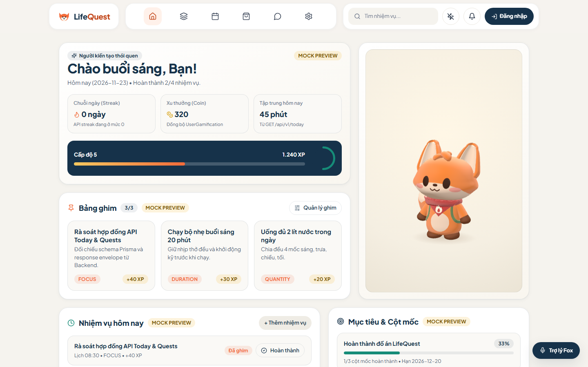

# FE-03.5C — Desktop Layout Refinement Report

- **Repository:** `D:\Development\LifeQuest_Repo`
- **Branch:** `feature/tv4-frontend` (base FE-03.5B commit `d5cd97013be71ba95842f5f9b9b913db1e007b8e`)
- **Approved Scope (2 changes only, Desktop `>= 1024px`):**
  1. Remove the Desktop Sidebar entirely and eliminate its reserved `248px` left margin.
  2. Expand the Fox V2 Mascot container **vertically** (`grid-row: 1 / span 2`) alongside the Hero Info Card (Row 1) and `Bảng ghim` (Row 2), while preserving its original column width (`minmax(280px, 0.85fr)`).

---

## 1. Before / After Visual Comparison (`1440×900`)

### Before (With 248px Desktop Sidebar + Single-Row Mascot)

### After (Sidebar Removed + 2-Row Vertical Fox V2 Companion Stage)

### Additional Desktop Breakpoints Verified
- **`1024×900`:** [fe03_5c_dashboard_1024x900.png](screenshots/fe03_5c_dashboard_1024x900.png)
- **`1280×900`:** [fe03_5c_dashboard_1280x900.png](screenshots/fe03_5c_dashboard_1280x900.png)
- **`1920×1080`:** [fe03_5c_dashboard_1920x1080.png](screenshots/fe03_5c_dashboard_1920x1080.png)

---

## 2. Changed Files
- `front-end/src/components/shell/AppShell.tsx` & `AppShell.module.css` — removed Desktop `<aside>` Sidebar and reserved `248px` column; Tablet & Mobile nav untouched.
- `front-end/src/components/shell/DesktopHeader.tsx` — added `/settings` icon link to the Center Nav Island so all 6 routes remain 1-click reachable on Desktop.
- `front-end/src/features/dashboard/DashboardPage.tsx` & `DashboardPage.module.css` — added `.topGrid` (`minmax(0, 1.45fr) minmax(280px, 0.85fr)`) with `.mascotSpan { grid-column: 2; grid-row: 1 / span 2; }`, reverting to single-column stack below `1024px`.
- `front-end/src/features/dashboard/HeroSection.tsx` — separated Hero Info Card cleanly for `.topGrid` Row 1 Col 1.
- `front-end/src/features/mascot/FoxCanvas.module.css` — set `.stage { flex: 1; height: 100%; min-height: 260px; }` so the R3F canvas naturally fills the 2-row vertical stage without clipping or overlap.
- `front-end/src/features/dashboard/DashboardPage.test.tsx` & `front-end/e2e/dashboard.spec.ts` — updated selectors and added explicit assertions for zero `<aside>` sidebar and 2-row vertical mascot span across `1024`, `1280`, `1440`, and `1920px`.
