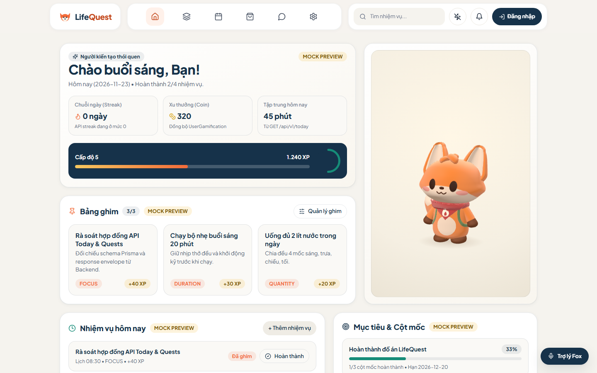
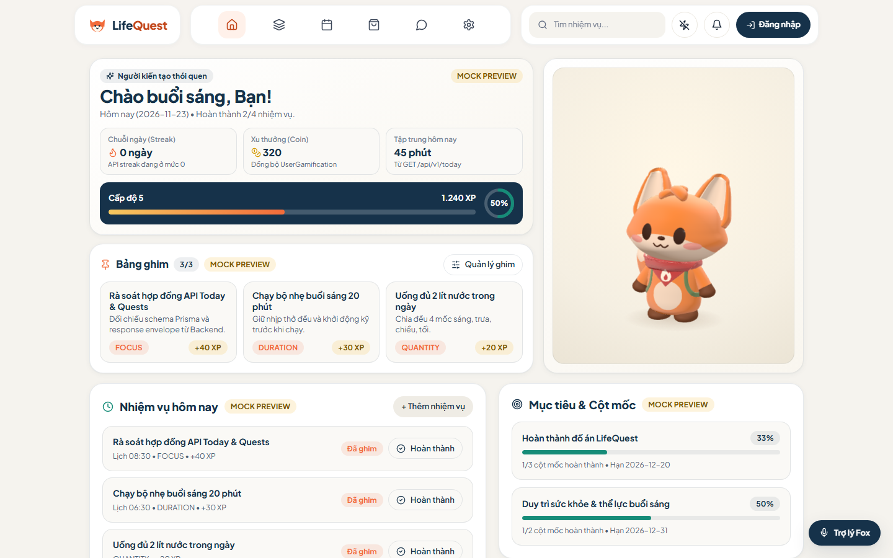

# FE-03.5D — Desktop Dashboard Fit-to-Viewport Report

- **Repository:** `D:\Development\LifeQuest_Repo`
- **Branch:** `feature/tv4-frontend` (base FE-03.5C commit `e4cfad412fd12cb51ced82bbb5606d98e4abb0e5`)
- **Primary Acceptance Viewport:** `1440×900` (Header + Hero + Pinned Board + 2-row Fox V2 Companion Card fully visible above the initial fold without vertical scrolling).

---

## 1. Before / After Visual Comparison (`1440×900`)

### Before (FE-03.5C — Bottom at `734px`)

### After (FE-03.5D — Bottom at `602px`, `-132px` saved)

### Additional Desktop Breakpoints Verified
- **`1280×900`:** [fe03_5d_dashboard_1280x900.png](screenshots/fe03_5d_dashboard_1280x900.png)
- **`1024×900`:** [fe03_5d_dashboard_1024x900.png](screenshots/fe03_5d_dashboard_1024x900.png)
- **`1920×1080`:** [fe03_5d_dashboard_1920x1080.png](screenshots/fe03_5d_dashboard_1920x1080.png)

---

## 2. Measured Viewport Boundaries (Exact Pixels)

| Viewport | Element | Before (`FE-03.5C`) | After (`FE-03.5D`) | Delta | Above Fold? |
|---|---|---|---|---|---|
| **`1440×900`** | Header | `0 → 80px` (`80px`) | `0 → 80px` (`80px`) | `0px` | Yes |
| **`1440×900`** | Hero Info Card | `104 → 452px` (`348px`) | `94 → 379px` (`285px`) | `-63px` | Yes |
| **`1440×900`** | Pinned Board (`Bảng ghim`) | `472 → 734px` (`262px`) | `393 → 602px` (`209px`) | `-53px` | **Yes (`602 <= 900`)** |
| **`1440×900`** | Fox V2 Mascot Card | `104 → 734px` (`630px`) | `94 → 602px` (`508px`) | `-122px` | **Yes (`602 === 602`)** |
| **`1280×900`** | Pinned Board & Mascot Bottom | `734px` | **`602px`** | `-132px` | **Yes (`602 <= 900`)** |
| **`1024×900`** | Pinned Board & Mascot Bottom | `763px` | **`629px`** | `-134px` | **Yes (`629 <= 900`)** |
| **`1920×1080`** | Pinned Board & Mascot Bottom | `734px` | **`602px`** | `-132px` | **Yes (`602 <= 1080`)** |

---

## 3. Updated Layout Dimensions & Changed Files
- `front-end/src/components/shell/AppShell.module.css` — tightened desktop `.content` top padding (`24px → 14px`).
- `front-end/src/features/dashboard/DashboardPage.module.css` — tightened `.stack` (`20px → 16px`) and `.topGrid` (`gap: 14px 16px`), added viewport-aware `.mascotSpan { min-height: min(460px, calc(100dvh - 120px)); padding: 14px; }`.
- `front-end/src/features/dashboard/HeroSection.module.css` & `HeroSection.tsx` — compacted Hero card (`compact`), internal gap (`18px → 12px`), stat tiles (`9px 12px`), XP strip (`10px 14px`, `ProgressRing` `48px` with `onDark` white `#FFFFFF` label contrast).
- `front-end/src/components/ui/ProgressRing.tsx` — added `onDark` prop so the `50%` label renders `#FFFFFF` with readable `rgba(255,255,255,0.22)` track inside the navy XP strip.
- `front-end/src/features/dashboard/PinnedBoard.module.css` & `PinnedBoard.tsx` — compacted card padding (`16px → 12px 14px`), grid gap (`14px → 10px`), and 2-line description clamp for uniform 3-card height.
- `front-end/e2e/dashboard.spec.ts` — added Playwright viewport bottom-boundary assertions (`pinned.bottom <= height`, `mascot.bottom <= height`, `|mascot.bottom - pinned.bottom| <= 2`).
