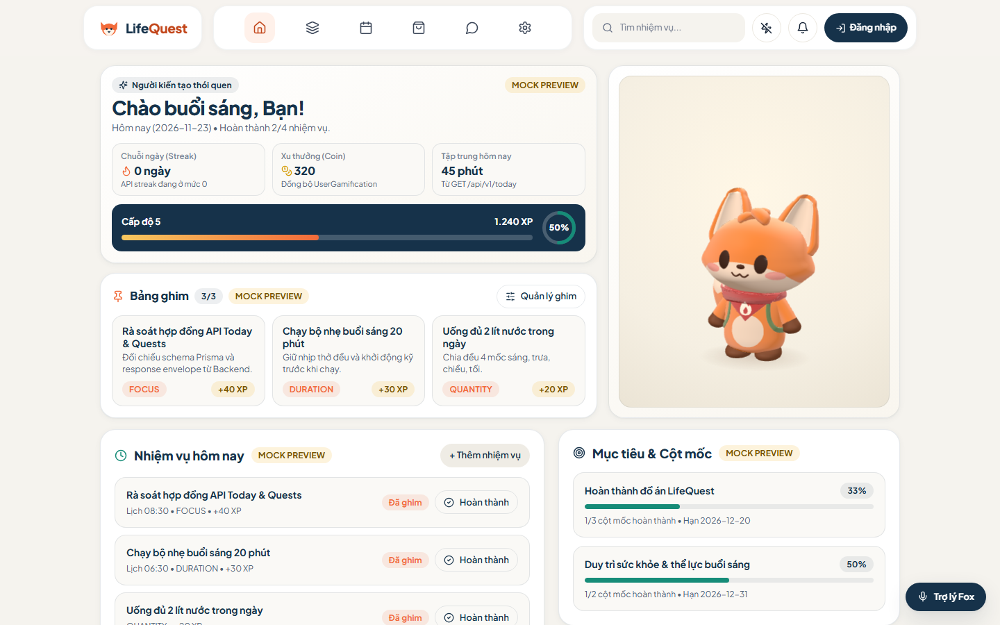
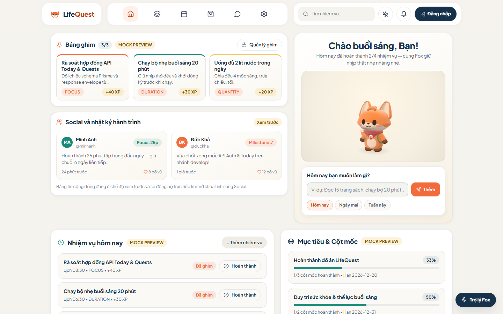

# FE-03.5E — Desktop Dashboard Hero Redesign Report

- **Repository:** `D:\Development\LifeQuest_Repo`
- **Branch:** `feature/tv4-frontend` (base FE-03.5D commit `527f1e5e66442f13dec2a9291ee4b1bfef1208d9`)
- **Scope:** Desktop (`>= 1024px`) Dashboard Hero & left showcase refinement only. Header, Tablet/Mobile layouts, Work Hub, Calendar, Settings, Wardrobe, Voice Assistant, Backend APIs, and Mascot SDK remain unchanged.

---

## 1. Before / After Visual Comparison (`1440×900`)

### Before (Technical Left Greeting Grid + Separate Mascot Card)

### After (Mascot Greeting + "Hôm nay bạn muốn làm gì?" Right; Bảng ghim + Social Left)

### Additional Desktop Breakpoints Verified
- **`1280×900`:** [fe03_5e_dashboard_1280x900.png](screenshots/fe03_5e_dashboard_1280x900.png)
- **`1024×900`:** [fe03_5e_dashboard_1024x900.png](screenshots/fe03_5e_dashboard_1024x900.png)
- **`1920×1080`:** [fe03_5e_dashboard_1920x1080.png](screenshots/fe03_5e_dashboard_1920x1080.png)

---

## 2. Layout Rationale & Changes Implemented
1. **Removed Technical Left Greeting Grid on Desktop:** Hidden the old `HeroSection` (Streak/Coin/Focus/XP cards) on Desktop (`>= 1024px`) while preserving it untouched for Tablet & Mobile (`< 1024px`).
2. **Moved Greeting into Mascot Focal Panel (`MascotHeroPanel.tsx`):** Centered `Chào buổi sáng, {displayName}!` (neutral fallback `Bạn`) and a warm supporting line directly above the live 3D Fox V2 stage on the right column.
3. **Added `"Hôm nay bạn muốn làm gì?"` Action Box Below Fox:** Compact input field, terracotta `Thêm` send button, and selectable `Hôm nay` / `Ngày mai` / `Tuần này` chips. Calls real `POST /api/v1/quests` (emitting `TASK_CREATED` on `201`) when authenticated; displays an honest sign-in prompt when unauthenticated (never fakes Backend persistence).
4. **Richer Left Showcase:** Elevated `Bảng ghim` (with warm terracotta/emerald/gold top card accents) and `Social và nhật ký hành trình` (2-column activity cards with teal/coral initials avatars and a friendly `"Xem trước"` chip) into the primary left column. Lower sections (`Nhiệm vụ hôm nay`, `Mục tiêu & Cột mốc`) remain cleanly accessible below.

---

## 3. Changed Files
- `front-end/src/features/dashboard/MascotHeroPanel.tsx` & `MascotHeroPanel.module.css` (new)
- `front-end/src/features/dashboard/DashboardPage.tsx` & `DashboardPage.module.css`
- `front-end/src/features/dashboard/PinnedBoard.module.css`
- `front-end/src/features/dashboard/SocialPreviewPanel.tsx` & `SocialPreviewPanel.module.css`
- `front-end/src/features/dashboard/DashboardPage.test.tsx` & `front-end/e2e/dashboard.spec.ts`
- `docs/frontend/fe03_5/FE03_5E_DASHBOARD_REDESIGN_REPORT.md` & `screenshots/fe03_5e_dashboard_*.png`

---

## 4. Remaining Differences vs Older Reference
- `Social và nhật ký hành trình` remains explicitly preview-only (`Xem trước`) until Backend merges `origin/feature/friends-and-social`.
- `"Hôm nay bạn muốn làm gì?"` creates real `SIMPLE` quests via `POST /api/v1/quests` rather than AI natural-language parsing (no Backend AI parser exists yet).

---

## 5. Regression Test Results
- `npm run typecheck`: **PASS** (0 errors)
- `npm run lint`: **PASS** (0 errors, 0 warnings)
- `npm run build`: **PASS** (`32/32` Gate I assets verified)
- `npm run test` (Vitest): **PASS** (**11/11 files, 35/35 tests**)
- `npm run test:e2e` (Playwright): **PASS** (**12/12 tests** across `1024/1280/1440/1920px` Desktop, `820×1180` Tablet, `390×844` Mobile)
