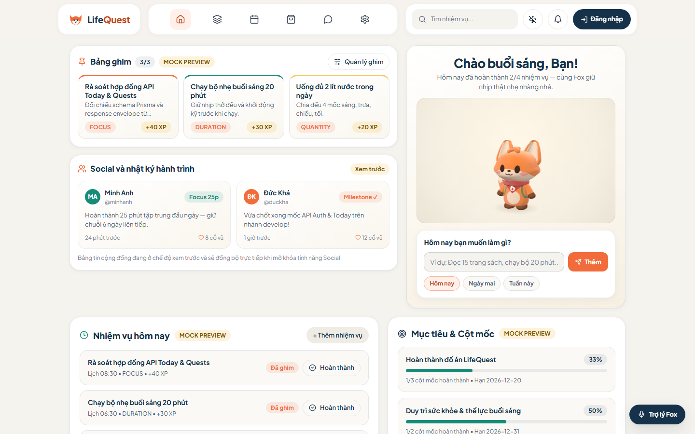
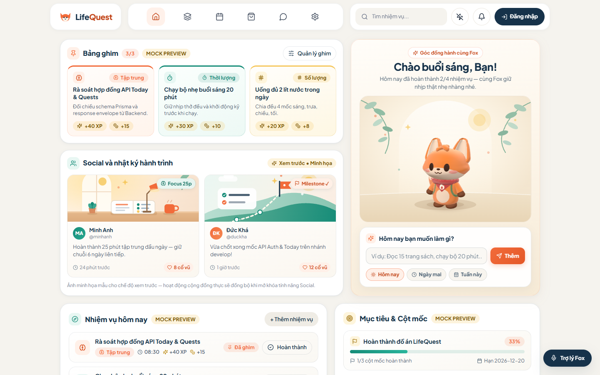

# FE-03.5E — Desktop Dashboard Visual Enrichment Report

**Branch:** `feature/tv4-frontend`  
**Scope:** Desktop (`>= 1024px`) visual enrichment of the LifeQuest Dashboard, guided by the approved Claude Canvas aesthetic and the Mandatory UI/UX Visual Balance Policy.  
**Untouched:** Tablet & Mobile layouts (`< 1024px`), Work Hub, Calendar, Settings, Wardrobe, Desktop 3-island Header, Backend APIs, Mascot Gate I SDK, and Fox V2 GLB assets.

---

## 1. Visual Comparison (Before vs After at 1440×900)

| Before (FE-03.5E Structural Baseline) | After (FE-03.5E Visual Enrichment) |
| :---: | :---: |
|  |  |

### Additional Desktop Viewport Captures
- **1280×900:** `screenshots/fe03_5e_enriched_1280x900.png`
- **1024×900:** `screenshots/fe03_5e_enriched_1024x900.png`
- **1920×1080:** `screenshots/fe03_5e_enriched_1920x1080.png`

---

## 2. Visual Balance & Geometry Audit

| Viewport | Horizontal Overflow | `Bảng ghim` Bottom | Left Column Bottom (`Social`) | Right Column Bottom (`Mascot`) | Column Alignment Delta |
| :--- | :---: | :---: | :---: | :---: | :---: |
| **1440×900** | `false` | `344px` | `710px` | `710px` | **`0px`** |
| **1280×900** | `false` | `344px` | `710px` | `710px` | **`0px`** |
| **1024×900** | `false` | `373px` | `757px` | `757px` | **`0px`** |
| **1920×1080** | `false` | `344px` | `710px` | `710px` | **`0px`** |

- Both primary Desktop columns align to the exact pixel (`delta = 0px`) across all 4 required widths.
- The entire primary showcase (3-island Header, `Bảng ghim`, `Social và nhật ký hành trình`, Mascot Greeting, Botanical Fox V2 stage, and `"Hôm nay bạn muốn làm gì?"`) fits cleanly inside the initial `900px` viewport without crowding or clipping, while `Nhiệm vụ hôm nay` and `Mục tiêu & Cột mốc` peek cleanly below.
- Zero overlap between floating badges and underlying SVG illustrations (`study-corner.svg` and `milestone-moment.svg` were tuned after initial screenshot inspection).

---

## 3. Decorative Design Decisions

### Mascot Companion Stage (`MascotSceneBackdrop.tsx` + `MascotHeroPanel`)
- Leveraged `FoxCanvas`'s existing `gl={{ alpha: true }}` WebGL transparency by applying a transparent stage class (`foxCanvasTransparent`) inside `MascotHeroPanel` — adding rich background art with **zero changes** to the Fox V2 SDK, animation controller, or GLB files.
- Added a lightweight `pointer-events: none` vector backdrop (`MascotSceneBackdrop.tsx`) featuring:
  - Warm sunlit cream-to-amber radial glow and a soft arched interior alcove framing Fox V2.
  - Gentle hanging sage/eucalyptus branches & vines with subtle coral/gold berry accents in the upper corners.
  - A soft warm floor horizon band and grounded elliptical contact shadow directly under Fox's feet.
- Paired the greeting with a warm `Góc đồng hành cùng Fox` pill and enriched the `"Hôm nay bạn muốn làm gì?"` box with semantic icons (`Sparkles`, `Sun`, `Clock`, `CalendarDays`).

### Color & Section Identity
- **Bảng ghim (`PinnedBoard`):** Upgraded from plain white cards to tasteful pastel-tinted surfaces (peach-cream, mint-cream, honey-cream) with matching top accent borders, circular type icon tiles, and coral header badge.
- **Social và nhật ký hành trình (`SocialPreviewPanel`):** Added full-bleed `112px` rounded illustration banners, frosted category badge pills, gradient initials avatars, `Xem trước • Minh họa` honesty pill, and warm coral cheer pills.
- **Nhiệm vụ hôm nay & Mục tiêu & Cột mốc (`TodayFeed`, `GoalsProgressPanel`):** Added matching pastel section icon badges (`30×30`), per-quest semantic icon tiles (`36×36`), XP/Coin reward indicators, and gradient emerald progress bars.

---

## 4. Original Reusable Mock Assets Created

All assets are original, lightweight SVGs stored in `front-end/src/assets/social/` and exported via `front-end/src/assets/social/index.ts`:

| Asset | Theme | Usage |
| :--- | :--- | :--- |
| `study-corner.svg` | Sunlit cozy study desk, open notebook, desk lamp, steaming terracotta mug, succulent | Active in Social preview card 1 (`Focus 25p`) |
| `milestone-moment.svg` | Rolling sage hills, dotted progress trail, summit flag, completed checklist card | Active in Social preview card 2 (`Milestone ✓`) |
| `morning-run.svg` | Sunrise park trail, rolling hills, stylized trees, `20 phút` pace badge | Reusable library asset for exercise moments |
| `hydration-habit.svg` | Fresh water tumbler with mint sprig, daily droplet progress, `2.0 Lít` badge | Reusable library asset for hydration habits |

---

## 5. Semantic Task & Content Icon System

Created `front-end/src/components/ui/QuestIcons.tsx` built on `lucide-react`:

| Concept | Icon | Label / Badge |
| :--- | :--- | :--- |
| Task (`SIMPLE`) | `CheckSquare` | `Nhiệm vụ` |
| Habit | `Repeat` | `Thói quen` |
| Quest | `Compass` | `Thử thách` |
| Milestone | `Flag` | `Cột mốc` |
| Focus (`FOCUS`) | `Brain` | `Tập trung` |
| Duration (`DURATION`) | `Timer` | `Thời lượng` |
| Quantity (`QUANTITY`) | `Hash` | `Số lượng` |
| Progress (`PROGRESS`) | `TrendingUp` | `Tiến độ` |
| Reward / Coin | `Coins` | `+{coins}` |
| XP | `Sparkles` | `+{xp} XP` |
| Activity / Social | `Heart` / `Users` | `{n} cổ vũ` |

---

## 6. Changed Files

- `front-end/src/assets/social/study-corner.svg` *(new)*
- `front-end/src/assets/social/milestone-moment.svg` *(new)*
- `front-end/src/assets/social/morning-run.svg` *(new)*
- `front-end/src/assets/social/hydration-habit.svg` *(new)*
- `front-end/src/assets/social/index.ts` *(new)*
- `front-end/src/components/ui/QuestIcons.tsx` & `front-end/src/components/ui/questIconMeta.ts` *(new)*
- `front-end/src/features/dashboard/MascotSceneBackdrop.tsx` *(new)*
- `front-end/src/features/dashboard/MascotHeroPanel.tsx` & `MascotHeroPanel.module.css`
- `front-end/src/features/dashboard/PinnedBoard.tsx` & `PinnedBoard.module.css`
- `front-end/src/features/dashboard/SocialPreviewPanel.tsx` & `SocialPreviewPanel.module.css`
- `front-end/src/features/dashboard/TodayFeed.tsx` & `TodayFeed.module.css`
- `front-end/src/features/dashboard/GoalsProgressPanel.tsx` & `GoalsProgressPanel.module.css`
- `front-end/src/types/domain.ts` & `front-end/src/services/repositories/fixtures.ts`
- `front-end/src/features/dashboard/DashboardPage.test.tsx` & `front-end/e2e/dashboard.spec.ts`
- `docs/frontend/fe03_5/FE03_5E_VISUAL_ENRICHMENT_REPORT.md` *(new)*
- `docs/frontend/fe03_5/screenshots/fe03_5e_enriched_{1024x900,1280x900,1440x900,1920x1080}.png` *(new)*

---

## 7. Remaining Gaps vs Original Claude Direction

1. **Live Social Feed & Cheer Persistence:** Currently clearly marked `Xem trước • Minh họa`; awaits Backend merge of `origin/feature/friends-and-social` into `develop`.
2. **Quest Execution Completion (`Hoàn thành`):** Still honestly surfaces `UNAVAILABLE` until Backend exposes QuestExecution completion endpoints on `develop`.
3. **Interactive Mascot Room Themes / Cosmetics in Scene:** The botanical backdrop is currently a static warm daytime theme; future milestones can optionally sync backdrop tinting with time-of-day (morning/afternoon/evening) or equipped seasonal wardrobe sets.
