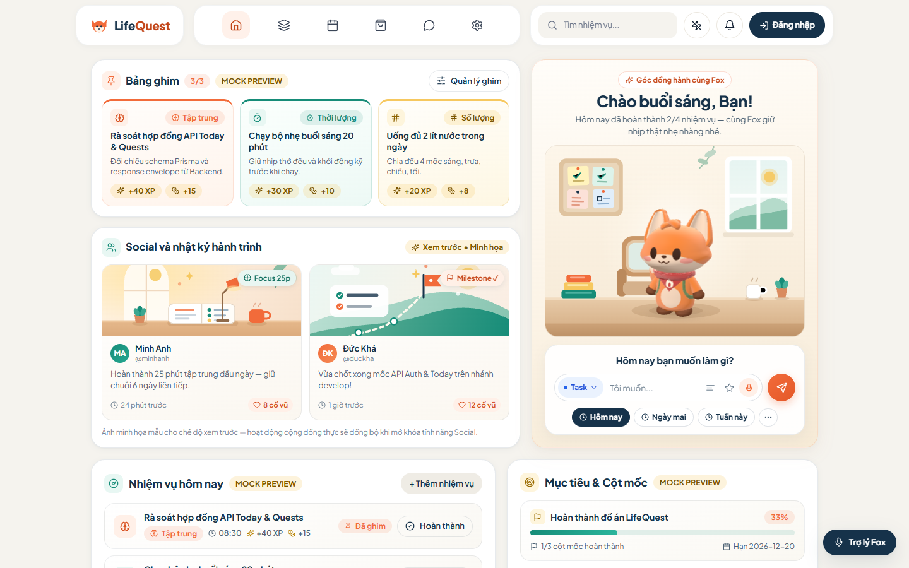
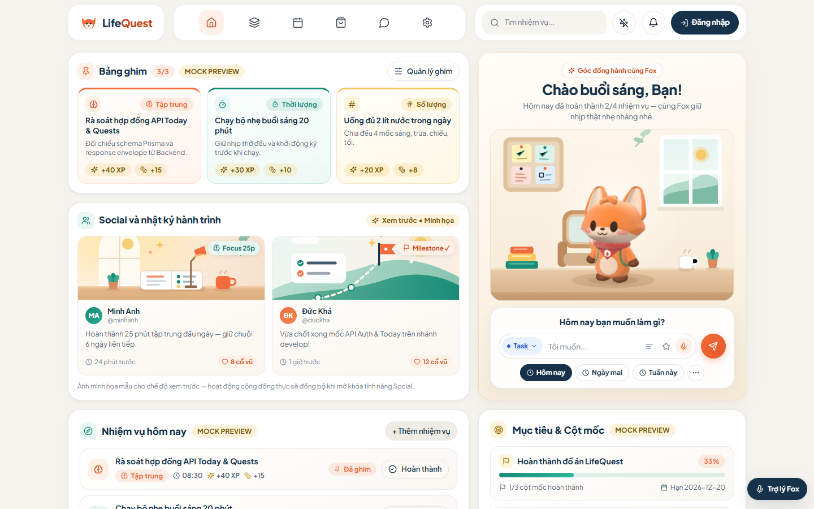

# FE-03.5F — Desktop Dashboard Layout Balance Report

**Branch:** `feature/tv4-frontend`  
**Base Commit Inspected:** `1dd8f20`  
**Scope:** Geometric container alignment, unified Desktop spacing tokens, vertical viewport balance, and non-overlapping Floating Fox Assistant placement on Desktop (`>= 1024px`).  
**Untouched:** Color palette, original social mock imagery, semantic task icons, decorative Fox V2 study-room scene, Header visual identity, Tablet/Mobile layouts (`< 1024px`), Work Hub, Calendar, Settings, Wardrobe, Backend APIs, Mascot Gate I SDK, and Fox GLB assets.

---

## 1. Visual Comparison (Before vs After at 1440×900)

| Before (`1dd8f20` — 24px Outer Misalignment) | After (FE-03.5F — 0px Outer Alignment) |
| :---: | :---: |
|  |  |

### Additional Viewport Captures
- **1280×900:** [Before](screenshots/fe03_5f_before_1280x900.png) • [After](screenshots/fe03_5f_after_1280x900.png)
- **1024×900:** [Before](screenshots/fe03_5f_before_1024x900.png) • [After](screenshots/fe03_5f_after_1024x900.png)
- **1920×1080:** [Before](screenshots/fe03_5f_before_1920x1080.png) • [After](screenshots/fe03_5f_after_1920x1080.png)

---

## 2. Measured Browser Geometry (Before vs After)

### Root Cause Identified in Phase 1
- `DesktopHeader.module.css` applied `padding: 0 24px` (and `0 16px` at `1024–1180px`) *outside* `.grid { max-width: 1200px }`, giving Header islands an outer span of **`1200px`** (`120..1320px` at `1440px`, `16..1008px` at `1024px`).
- `AppShell.module.css` applied `padding: 14px 24px 24px` *inside* `.content { max-width: 1200px; box-sizing: border-box }`, shrinking the Dashboard inner span to **`1152px`** (`144..1296px` at `1440px`) and **`976px`** (`24..1000px` at `1024px`) — creating a **`24px`** left/right misalignment at `1280/1440/1920px` and **`8px`** at `1024px`.

### Exact Coordinates & Deltas

| Viewport | Metric | Before (`1dd8f20`) | After (FE-03.5F) | Target |
| :--- | :--- | :---: | :---: | :---: |
| **1440×900** | Header Islands Span (`left..right`, `w`) | `120..1320` (`1200px`) | `120..1320` (`1200px`) | Shared container |
| | Dashboard Outer Span (`left..right`, `w`) | `144..1296` (`1152px`) | `120..1320` (`1200px`) | Shared container |
| | Header → Dashboard Left / Right Delta | **`+24px / +24px`** | **`0px / 0px`** | `<= 4px` |
| | Left Col Bottom (`Social`) / Right Col Bottom (`Mascot`) | `710px / 710px` (`0px`) | `708px / 708px` (`0px`) | Aligned, `<= 900px` |
| | Quick Create Bottom / Mascot Stage Height | `689px` / `304px` | `687px` / `304px` | Fully visible |
| | Floating Fox Button (`left..right`, `top..bottom`) | `1304..1420`, `839..880` | `1322..1428`, `845..884` | Outside container (`> 1320px`) |
| **1280×900** | Header → Dashboard Left / Right Delta | **`+24px / +24px`** | **`0px / 0px`** | `<= 4px` |
| | Left / Right Column Bottom (`delta`) | `710px / 710px` (`0px`) | `708px / 708px` (`0px`) | Aligned |
| | Quick Create Bottom vs Floating Fox Top | `689px` vs `839px` | `687px` vs `845px` | No overlap (`158px` gap) |
| **1920×1080** | Header → Dashboard Left / Right Delta | **`+24px / +24px`** | **`0px / 0px`** | `<= 4px` |
| | Left / Right Column Bottom (`delta`) | `710px / 710px` (`0px`) | `708px / 708px` (`0px`) | Aligned |
| | Floating Fox Button (`left`) vs Dashboard (`right`) | `1784px` vs `1536px` | `1784px` vs `1560px` | Outside container (`224px` gap) |
| **1024×900** | Header → Dashboard Left / Right Delta | **`+8px / +8px`** | **`0px / 0px`** | `<= 4px` |
| | Left / Right Column Bottom (`delta`) | `757px / 757px` (`0px`) | `726px / 726px` (`0px`) | Aligned (`31px` tighter) |
| | Quick Create Height / Bottom | `179px` / `736px` | `141px` / `709px` | Single-row chips, no overlap |

All 4 viewports report `overflow: false`, `columnGap: 16px`, `floatingOverlapsQuickCreate: false`, and `floatingOverlapsMascotPanel: false`.

---

## 3. Adjusted CSS & Layout Values

- **`front-end/src/styles/tokens.css`:**
  - Added shared Desktop layout tokens: `--lq-container-max: 1200px`, `--lq-page-gutter: 24px`, `--lq-grid-gap: 16px`.
- **`front-end/src/components/shell/DesktopHeader.module.css`:**
  - Bound `.desktopHeader` horizontal padding to `var(--lq-page-gutter)`, `.grid` `max-width` to `var(--lq-container-max)`, and island gap to `var(--lq-grid-gap)`.
- **`front-end/src/components/shell/AppShell.module.css`:**
  - Updated `.content` to `max-width: calc(var(--lq-container-max) + 2 * var(--lq-page-gutter))` with `padding: 12px var(--lq-page-gutter) 84px` (and matching `16px` gutter at `1024px–1180px`) so inner content matches Header's `1200px` / `992px` outer edges to the exact pixel and preserves bottom scroll clearance above the floating button.
- **`front-end/src/features/dashboard/DashboardPage.module.css`:**
  - Unified `.stack`, `.mainShowcase`, `.leftShowcase`, and `.lowerGrid` gaps to `var(--lq-grid-gap)` (`16px`) and matched `.lowerGrid` column track ratio (`1.38fr 0.92fr`) to `.mainShowcase` so vertical column gutters align cleanly down the page.
- **`front-end/src/features/dashboard/MascotHeroPanel.module.css`:**
  - Added compact chip padding at `1024px–1180px` (`padding: 4px 8px; font-size: 11.5px`) so all 4 Quick Create horizon chips (`Hôm nay`, `Ngày mai`, `Tuần này`, `•••`) stay on a single row (`-38px` vertical height saved at `1024×900`).
- **`front-end/src/features/mascot/FloatingMascotDock.module.css`:**
  - Refined button sizing (`padding: 9px 13px; right: 12px; bottom: 16px` on `1024–1519px`; `right: 20px; bottom: 20px` on `>= 1520px`) so at `1440×900` and `1920×1080` it sits entirely outside the `1200px` Dashboard right edge (`left: 1322px > right: 1320px`).

---

## 4. Visual Balance Assessment

- **Outer Alignment:** Header islands and Dashboard panels now form a single crisp vertical edge on both left and right (`0px` delta across all 4 desktop viewports).
- **Column & Gutter Harmony:** Both top columns (`Bảng ghim + Social` and `Mascot Hero Panel`) end at the exact same baseline (`708px` at `1280/1440/1920px`, `726px` at `1024px`), and the vertical column split lines up directly with the lower `Nhiệm vụ hôm nay` / `Mục tiêu & Cột mốc` grid.
- **Mascot Framing:** Complete Fox V2 character remains prominently framed on its study desk inside the `304–335px` stage without clipping or blank spacer regions.
- **Quick Create & Voice Accessibility:** Quick Create (`Hôm nay bạn muốn làm gì?` + inline Mic button) is 100% visible above the fold at `900px` height with zero overlap from the Floating Fox Assistant button.

---

## 5. Known Limitations

- At narrow desktop widths (`1024×900` and `1280×900`), where the outer right viewport margin is `< 106px`, the fixed `Trợ lý Fox` pill sits in the bottom-right corner over the *lower* scrolled fold (`top: 845px`), never over Quick Create (`bottom: 687–709px`), and `.content` reserves `84px` of bottom padding so scrolling to the bottom clears all cards.

---

## 6. Regression Gates

- `npm run typecheck`: **PASS**
- `npm run lint`: **PASS** (0 errors, 0 warnings)
- `npm run build`: **PASS** (`32/32` Gate I assets verified)
- `npm run test` (Vitest): **PASS** (`11/11` files, `35/35` tests)
- `npm run test:e2e` (Playwright): **PASS** (`12/12` tests, including new `<= 4px` Header-to-Dashboard alignment and non-overlapping Floating Fox dock assertions across `1024`, `1280`, `1440`, `1920px`)
