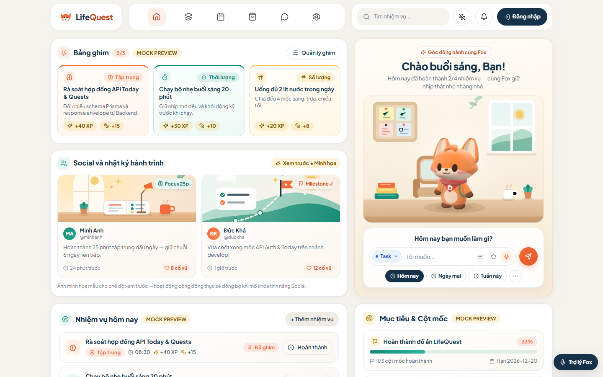
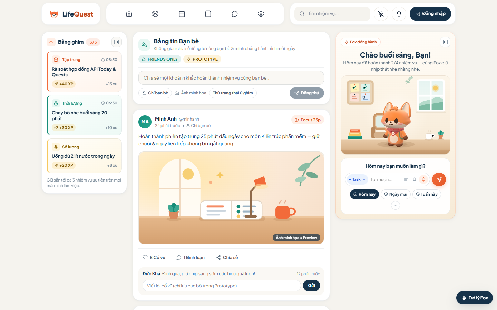

# FE-03.5G — Social-First Desktop Visual Prototype Report

**Isolated Preview Route:** `/preview/social-first`  
**Production Dashboard (`/`):** Preserved 100% untouched.  
**Data Mode:** Isolated prototype fixture state (`src/features/social-prototype/prototypeFixtures.ts`) — zero Backend mutations, zero modifications to Backend or Mascot Gate I SDK.

---

## 1. Before vs After Comparison (1440×900)

| Current Production Dashboard (`/`, FE-03.5F) | FE-03.5G Social-First 3-Region Prototype (`/preview/social-first`) |
| :---: | :---: |
|  |  |

---

## 2. Six Required UI States (1440×900 Visual Evidence)

| State | Measured Column Widths (`L / C / R`) | Screenshot |
| :--- | :---: | :--- |
| **1. All panels expanded** | `248px` / `572px` / `348px` | [fe03_5g_expanded_1440x900.png](screenshots/fe03_5g_expanded_1440x900.png) |
| **2. Pinned Tasks collapsed** | `56px` / `764px` / `348px` | [fe03_5g_pinned_collapsed_1440x900.png](screenshots/fe03_5g_pinned_collapsed_1440x900.png) |
| **3. Fox Companion collapsed** | `248px` / `864px` / `56px` | [fe03_5g_fox_collapsed_1440x900.png](screenshots/fe03_5g_fox_collapsed_1440x900.png) |
| **4. Both panels collapsed** | `56px` / `780px` (centered) / `56px` | [fe03_5g_both_collapsed_1440x900.png](screenshots/fe03_5g_both_collapsed_1440x900.png) |
| **5. No pinned tasks (auto-hidden)** | `0px (hidden)` / `836px` / `348px` | [fe03_5g_no_pins_1440x900.png](screenshots/fe03_5g_no_pins_1440x900.png) |
| **6. Social feed scrolled (`scrollY: 520px`)** | Sticky `L.top = 92px`, `R.top = 92px`, `C.top = -428px` | [fe03_5g_scrolled_1440x900.png](screenshots/fe03_5g_scrolled_1440x900.png) |

---

## 3. Multi-Viewport Desktop Matrix (4 Required Widths)

| Viewport | Overflow | WebGL `<canvas>` Count | Left Rail | Center Social Feed | Right Fox Rail | Screenshot |
| :--- | :---: | :---: | :---: | :---: | :---: | :--- |
| **1440×900** | `false` | `1` | `248px` (`120..368`) | `572px` (`384..956`) | `348px` (`972..1320`) | [fe03_5g_expanded_1440x900.png](screenshots/fe03_5g_expanded_1440x900.png) |
| **1280×900** | `false` | `1` | `248px` (`40..288`) | `572px` (`304..876`) | `348px` (`892..1240`) | [fe03_5g_expanded_1280x900.png](screenshots/fe03_5g_expanded_1280x900.png) |
| **1920×1080** | `false` | `1` | `248px` (`360..608`) | `572px` (`624..1196`) | `348px` (`1212..1560`) | [fe03_5g_expanded_1920x1080.png](screenshots/fe03_5g_expanded_1920x1080.png) |
| **1024×900** *(Compact Desktop)* | `false` | `1` | `56px` collapsed (`16..72`) | `588px` (`88..676`) | `316px` (`692..1008`) | [fe03_5g_expanded_1024x900.png](screenshots/fe03_5g_expanded_1024x900.png) |

---

## 4. Technical Verification (Phase 5)

- **Single Active WebGL Renderer:** `canvasCount === 1` verified across all 9 captured states and after collapse → expand cycling.
- **Unsent Quick Create Draft Preservation:** Typed `"Đọc 20 trang sách kiến trúc"` into `#proto-quick-prompt`, collapsed `FoxCompanionRail`, re-expanded it, and confirmed `inputValue === "Đọc 20 trang sách kiến trúc"` (`matches: true`) with a visual draft indicator dot on the collapsed Fox strip.
- **Sticky & Independent Scroll:** At `scrollY = 520px`, both `PinnedTaskRail` and `FoxCompanionRail` remained pinned at `top: 92px` directly below the `80px` sticky Header while the Center Social Feed scrolled smoothly.
- **Zero Production Impact:** All existing routes (`/`, `/work`, `/calendar`, `/settings`, `/wardrobe`, `/login`, `/register`) remain untouched; no Backend mutations or production mock fallbacks were added.

---

## 5. Prototype Files Created (Not Committed / Awaiting Approval)

- `front-end/src/features/social-prototype/prototypeFixtures.ts`
- `front-end/src/features/social-prototype/PinnedTaskRail.tsx` & `PinnedTaskRail.module.css`
- `front-end/src/features/social-prototype/SocialFeedColumn.tsx` & `SocialFeedColumn.module.css`
- `front-end/src/features/social-prototype/FoxCompanionRail.tsx` & `FoxCompanionRail.module.css`
- `front-end/src/features/social-prototype/SocialFirstPrototypePage.tsx` & `SocialFirstPrototypePage.module.css`
- `front-end/src/app/router.tsx` (added isolated `/preview/social-first` route only)
