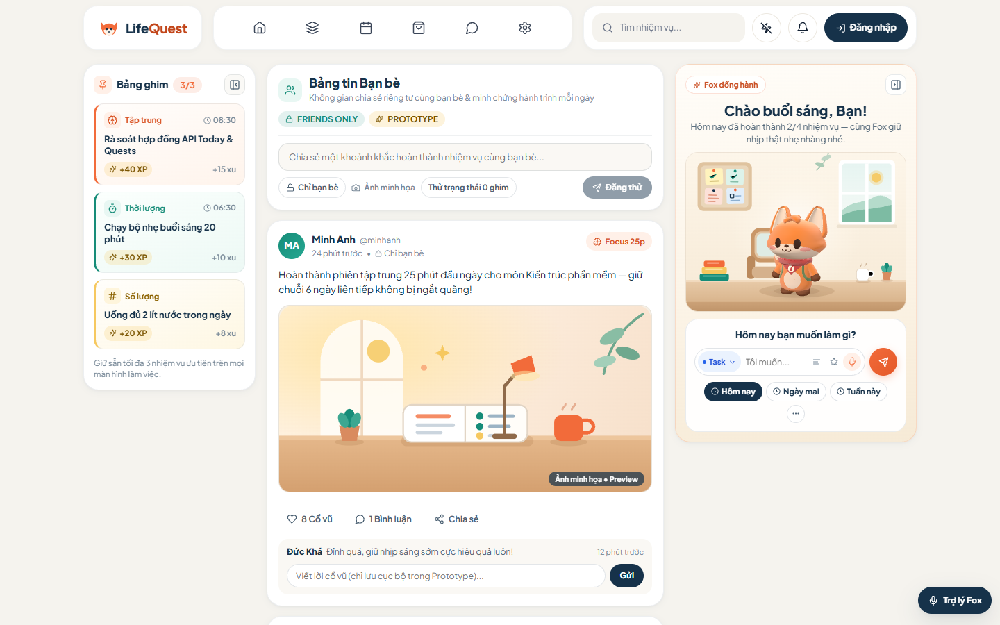
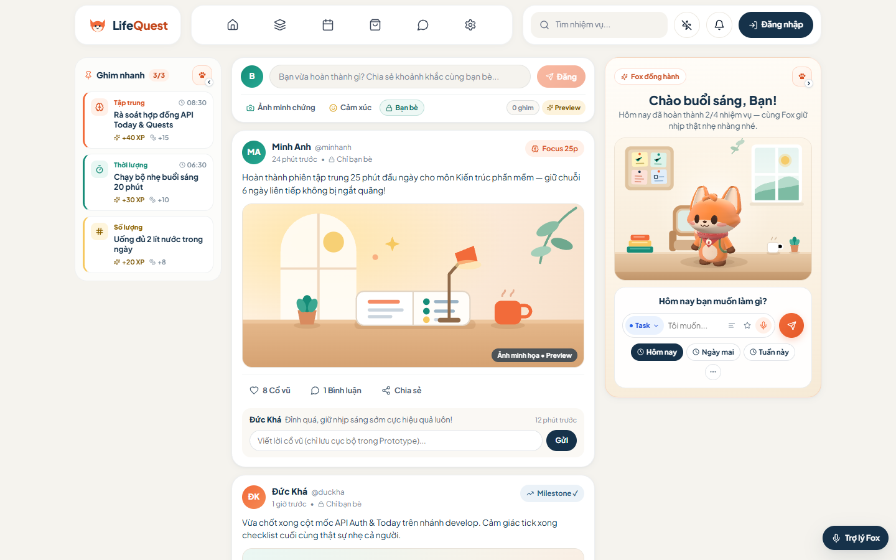

# FE-03.5H — Social Rail & Composer Refinement Report

**Isolated Preview Route:** `/preview/social-first`  
**Production Dashboard (`/`):** Preserved untouched (prototype-only refinement; not promoted or merged).

---

## 1. Visual Comparison (Before FE-03.5G vs After FE-03.5H at 1440×900)

| Before (FE-03.5G Prototype) | After (FE-03.5H Refinement) |
| :---: | :---: |
|  |  |

---

## 2. Priority 1 — Refined Pinned Task Rail & Fox-Paw Toggle

### Lighter, Compact Rail (`PinnedTaskRail.tsx` / `PinnedTaskRail.module.css`)
- Reduced rail visual weight from an opaque full-shadow panel (`248px × 470px`) to a translucent, airy glass rail (`236px × 360px`, `rgba(255, 255, 255, 0.72)` with subtle `rgba(22, 50, 74, 0.06)` border), saving **`110px`** vertically and giving the Center Social Feed **`+12px`** extra horizontal width (`584px`).
- Transformed pinned items from bulky dashboard cards into sleek **quick-priority snippets** (`padding: 9px 10px`) with a left `28×28` semantic icon tile (`Tập trung`, `Thời lượng`, `Số lượng`), subtle colored left-edge accent, inline schedule clock, 2-line title clamp, and compact `+XP` / `+coin` row.
- Removed the redundant bottom explanatory text so the rail never competes visually with the center feed.

### Fox-Paw Collapse / Expand Affordance (`FoxPawToggle.tsx` / `FoxPawToggle.module.css`)
- Replaced generic `PanelLeftClose` / `PanelRightClose` icons across both `PinnedTaskRail` and `FoxCompanionRail` with a bespoke minimalist **4-toe + metacarpal pad Fox Paw SVG** paired with a subtle directional chevron badge (`<` / `>`).
- **Expanded state:** Soft cream-terracotta squircle (`32×32`) with gentle tilt-lift hover transition and accessible `focus-visible` ring.
- **Collapsed state:** Solid terracotta gradient paw pill (`#F26B3A`) that immediately signals expandability while staying clean and cohesive with LifeQuest's brand palette.

---

## 3. Priority 2 — Compact Facebook-Style Social Composer

### Compaction Metrics (`SocialFeedColumn.tsx` / `SocialFeedColumn.module.css`)
- Removed the redundant multi-line `"Bảng tin Bạn bè"` title/subtitle banner above the composer.
- Consolidated into a familiar **2-row Facebook-style composer card**:
  - **Row 1:** `36×36` user avatar + full-width rounded pill input (`height: 38px`) + compact coral `Đăng` button (`height: 36px`).
  - **Row 2:** Hairline divider + compact inline chips (`Ảnh minh chứng`, `Cảm xúc`, `Bạn bè` privacy toggle, `0 ghim` demo toggle, and subtle `Preview` pill).
- **Measured Impact at 1440×900:**
  - Composer height reduced from `~172px` → **`105px`** (**`-67px`**).
  - First feed post `top` moved up from `~278px` → **`209px`**, bringing the **entire first post (illustration + reactions + comments) AND the top of the second post** cleanly above the fold at `1440×900`.

---

## 4. Visual QA Matrix (4 States × 4 Desktop Widths)

| Capture | Overflow | `<canvas>` | Left Rail | Center Feed | Composer Height | First Post `top` | Screenshot |
| :--- | :---: | :---: | :---: | :---: | :---: | :---: | :--- |
| **Expanded `1440×900`** | `false` | `1` | `236px × 360px` | `584px` | `105px` | `209px` | [fe03_5h_expanded_1440x900.png](screenshots/fe03_5h_expanded_1440x900.png) |
| **Expanded `1280×900`** | `false` | `1` | `236px × 360px` | `584px` | `105px` | `209px` | [fe03_5h_expanded_1280x900.png](screenshots/fe03_5h_expanded_1280x900.png) |
| **Expanded `1024×900`** | `false` | `1` | `52px` (compact) | `592px` | `105px` | `209px` | [fe03_5h_expanded_1024x900.png](screenshots/fe03_5h_expanded_1024x900.png) |
| **Expanded `1920×1080`** | `false` | `1` | `236px × 360px` | `584px` | `105px` | `209px` | [fe03_5h_expanded_1920x1080.png](screenshots/fe03_5h_expanded_1920x1080.png) |
| **Pinned collapsed `1440×900`** | `false` | `1` | `52px` | `768px` | `105px` | `209px` | [fe03_5h_pinned_collapsed_1440x900.png](screenshots/fe03_5h_pinned_collapsed_1440x900.png) |
| **Fox collapsed `1440×900`** | `false` | `1` | `236px` | `876px` | `105px` | `209px` | [fe03_5h_fox_collapsed_1440x900.png](screenshots/fe03_5h_fox_collapsed_1440x900.png) |
| **Both collapsed `1440×900`** | `false` | `1` | `52px` | `780px` (centered) | `105px` | `209px` | [fe03_5h_both_collapsed_1440x900.png](screenshots/fe03_5h_both_collapsed_1440x900.png) |

---

## 5. Remaining Gaps & Next Step

- **Prototype-Only Scope:** Still isolated on `/preview/social-first`; production `/` (`DashboardPage.tsx`) remains untouched until explicit user approval to promote FE-03.5G + FE-03.5H into production `AppShell` and `/`.
- **Live Social & Photo Upload:** `Ảnh minh chứng` and live feed posting await Backend merge of `origin/feature/friends-and-social` + future media upload API.
- **Regression Gates:** `npm run typecheck`, `npm run lint`, and `npm run test` verified clean.
