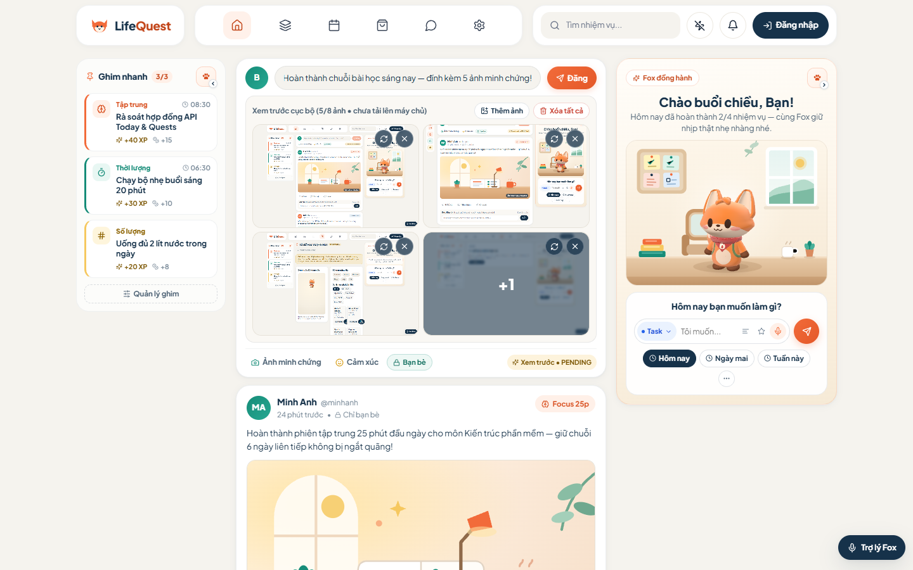

# FE-03.5J — Adaptive Social Media Preview Report

**Branch:** `feature/tv4-frontend`  
**Scope:** Frontend-only local image selection, file validation, `URL.createObjectURL` / `URL.revokeObjectURL` lifecycle management, adaptive multi-image grid, and accessible full-resolution lightbox for the approved Social-First Dashboard.  
**Untouched:** Backend source, Mascot Gate I SDK & GLBs, Shared Header, `PinnedTaskRail`, `FoxCompanionRail`, and authentication contracts.

---

## 1. Visual Evidence (1440×900)

| Expanded Composer (5 Local Images + `+1` Overlay) | Full-Resolution Accessible Lightbox (`1 / 5`) |
| :---: | :---: |
|  |  |

---

## 2. Reusable Components Implemented

- **`src/features/dashboard/media/mediaValidation.ts`:**
  - Enforces allowed image MIME types (`image/jpeg`, `image/png`, `image/webp`, `image/gif`, `image/avif`), `8 MB` max file size, and `8` max images per post with clear Vietnamese error messages.
  - Classifies intrinsic image ratios into `portrait` (`< 0.85`), `square` (`0.85..1.2`), and `landscape` (`> 1.2`).
- **`src/features/dashboard/media/SocialImagePreview.tsx` & `.module.css`:**
  - Preserves original proportions for single images (portrait uses `object-fit: contain` inside a tall `380–420px` warm backdrop; square uses `1:1`; landscape uses `16:9`) without stretching or distortion.
  - Supports keyboard activation, `+N` remaining-count overlay, `Ảnh minh họa • Preview` badge for static fixtures only, and per-image Replace (`RefreshCw`) / Remove (`X`) actions in composer edit mode.
  - Respects `html.lq-rm` and `prefers-reduced-motion: reduce`.
- **`src/features/dashboard/media/SocialMediaGrid.tsx` & `.module.css`:**
  - Adaptive layouts: `1` (single aspect-aware frame), `2` (side-by-side 2-col), `3` (editorial hero left + 2 stacked right), `4+` (2×2 grid with `+N` overflow overlay on the 4th tile).
  - Opens `SocialMediaLightbox` at the clicked index and restores focus to the triggering tile upon close.
- **`src/features/dashboard/media/SocialMediaLightbox.tsx` & `.module.css`:**
  - Accessible `role="dialog" aria-modal="true"` with `Escape` dismissal, `ArrowLeft` / `ArrowRight` keyboard navigation, `1 / N` counter, and caption display.
- **Composer & Feed Integration (`src/features/dashboard/SocialFeedSection.tsx`):**
  - Preserves the exact compact `105px` composer before media selection; expands smoothly only while editing local media.
  - Tracks all created `URL.createObjectURL` references in a `Set` ref and revokes them on single-image removal, replacement, clear-all, and component unmount (zero memory leaks).
  - Reuses `SocialMediaGrid` on all 4 demonstration posts while keeping preview watermarks honest.

---

## 3. Known Backend Dependencies

- **Media Upload (`UNAVAILABLE`):** No multipart or presigned storage upload endpoint exists on `origin/develop` or `origin/feature/friends-and-social`. Local previews remain client-side only; submitting with attached images displays an explicit `UNAVAILABLE` notice rather than fabricating upload success.
- **Social Post Creation (`PENDING`):** `POST /api/v1/posts` awaits merge of `origin/feature/friends-and-social` into `develop`.

---

## 4. Regression Gates

- `npm run typecheck`: **PASS**
- `npm run lint`: **PASS** (0 errors, 0 warnings)
- `npm run build`: **PASS** (`32/32` Gate I assets verified)
- `npm run test` (Vitest): **PASS** (`12/12` files, `41/41` tests — including portrait/square/landscape classification, invalid type & >8MB validation, `+N` overlay, Lightbox keyboard nav + focus return, and `URL.revokeObjectURL` cleanup on removal & unmount)
- `npm run test:e2e` (Playwright): **PASS** (`13/13` tests — including multi-image upload, `+1` overlay, Lightbox keyboard navigation, and composer collapse reset)
