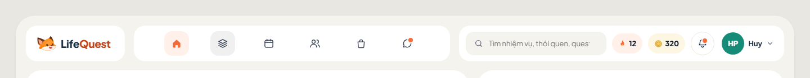
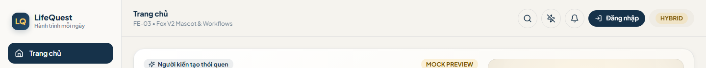

# FE-03.5A — Desktop Header Design Restoration Audit

- **Source of Truth:** `D:\Development\LifeQuest\LifeQuest Dashboard-project.zip` → `Main.dc.html` (`<header class="lq-apphd">`)
- **Current Implementation:** `D:\Development\LifeQuest_Repo\front-end\src\components\shell\AppShell.tsx` & `AppShell.module.css`
- **Branch:** `feature/tv4-frontend` @ `343d3a981224eaaaad9fc83b676e85f5453cf246`
- **Scope:** **Desktop Header only (`>= 1024px`)**. Sidebar, Dashboard sections, Tablet layout, Mobile navigation, Backend, Mascot SDK, and Authentication remain untouched in this audit.

---

## 1. Side-by-Side Visual Comparison (`1440×900`)

### Original Claude Canvas Desktop Header (`Main.dc.html`)

### Current Frontend Desktop Header (`AppShell.tsx`)

---

## 2. Exact Layout & Structural Differences

| Dimension | Original Claude Canvas (`Main.dc.html`) | Current Frontend (`AppShell.tsx`) | Classification |
|---|---|---|---|
| **Container Geometry** | 3-island CSS Grid (`grid-template-columns: auto minmax(0, 1fr) auto; gap: 16px`) inside `--lq-hdh: 80px` sticky glass bar; each island is `#FFFFFF`, `height: 64px`, `border-radius: 20px` | Single flat full-width translucent bar (`height: 76px`) with `border-bottom: 1px solid var(--lq-border)` | **RESTORE** |
| **Left Zone (Group 1)** | Brand Island (`176px × 64px`, `padding: 0 20px`, `border-radius: 20px`, `#FFFFFF`) with Fox SVG (`34×28`) + two-tone `Life` (`#16324A`) `Quest` (`#C2461A`), `19px / 800` | Plain text route title (`Trang chủ`, `15px`) + dev subtitle (`FE-03 • Fox V2 Mascot & Workflows`, `12px`); brand moved to sidebar | **ADAPT** *(see note below)* |
| **Center Zone (Group 2)** | Navigation Island (`height: 64px`, `padding: 0 28px`, `border-radius: 20px`, `#FFFFFF`) with 6 icon-only `44×44` (`radius: 14px`) buttons + hover tooltips (`.lq-tip`) + Work Hub popover (`Task` / `Habit` / `Quest`) | Empty whitespace (navigation lives in left Sidebar) | **ADAPT** *(see Sidebar coexistence note)* |
| **Right Zone (Group 3)** | Utility Island (`height: 64px`, `padding: 0 12px`, `gap: 10px`, `border-radius: 20px`, `#FFFFFF`) containing inline Search input, Streak pill, Coin pill, Notification bell, and Profile pill + dropdown bubble | Bare icon buttons (`Search`, `ZapOff`, `Bell`) + dark `Đăng nhập` pill + `HYBRID` pill floating directly on the flat bar | **RESTORE + ADAPT** |
| **Search** | Inline search input (`width: 250px`, `min-width: 140px`, `height: 42px`, `background: #F5F3EE`, `border-radius: 14px`, placeholder `"Tìm nhiệm vụ, thói quen, quest..."`) | `40×40` icon button opening `Search` modal sheet | **RESTORE** (inline search input wired to existing `uiStore.searchQuery`) |
| **Gamification Pills** | Streak pill (`height: 36px`, `bg: #FFF1EA`, flame icon + number) & Coin pill (`height: 36px`, `bg: #FDF6E3`, coin icon + number); hidden at `<= 1100px` | Absent from header (shown only in Dashboard Hero) | **ADAPT** (restore visual pills, bound to real `TodayData` when LIVE — never hardcoded `12`/`320` in production) |
| **Notification Bell** | `42×42` circle (`border: 1px solid #ECE8E0`, `bg: #FFFFFF`) with `#F26B3A` dot badge | `40×40` ghost button opening `Notifications` `UNAVAILABLE` sheet | **RESTORE + PRESERVE** (restore `42×42` styling; keep `UNAVAILABLE` sheet honesty, omit fake unread dot until Notifications API exists) |
| **Account / Auth Control** | `40×40` emerald `#168C78` initials avatar + user display name + chevron → `236px` dropdown bubble (display name, Level + XP progress bar, `Hồ sơ`, `Tủ đồ`, `Cài đặt`, `Đăng xuất`) | Direct `Đăng nhập` / `Đăng xuất` button + separate `HYBRID` badge | **ADAPT** (restore Profile pill + dropdown when authenticated using neutral fallback; show clean `Đăng nhập` pill in the same slot when unauthenticated; move `HYBRID`/`LIVE` API status & `lq-rm` toggle neatly inside Utility island or profile menu) |
| **Reduced-Motion Control (`lq-rm`)** | Controlled via `html.lq-rm` & `prefers-reduced-motion` (shrinks transition to `0.12s` fade-only) | Dedicated `40×40` `ZapOff` button in header | **PRESERVE** (keep accessible reduced-motion toggle and `aria-pressed` semantics so FE-01/FE-03 tests & users keep 1-click access) |
| **Sticky Glass & Scroll Compaction** | `.lq-apphd[data-hs="glass"]` with `--hbg: rgba(245,243,238,.84)` and compact brand sizing (`data-hc="1"`) suppressed under `html.lq-rm` | Static sticky glass (`rgba(245,243,238,0.82)`, `backdrop-filter: blur(14px)`) | **RESTORE** |

---

## 3. Original Claude Canvas Desktop Header Design Tokens

Extracted directly from `Main.dc.html`:

| Token / Property | Exact Value | Usage |
|---|---|---|
| `--lq-hdh` | `80px` (`76px` at `<= 640px`) | Header band height / scroll-margin offset |
| `--lq-ez` | `cubic-bezier(.2, .8, .2, 1)` | Header transition easing |
| Island surface | `#FFFFFF`, `height: 64px`, `border-radius: 20px` | Group 1, Group 2, Group 3 floating pills |
| Header grid gap | `16px` (`grid-template-columns: auto minmax(0, 1fr) auto`) | Separation between the 3 islands |
| Brand text | `19px`, `font-weight: 800`, `letter-spacing: -0.02em`, `Life` `#16324A` / `Quest` `#C2461A` | Brand wordmark |
| Nav icon button (`.lq-ni`) | `44px × 44px`, `border-radius: 14px`, inactive `#3B4658`, active `bg: #FFF1EA`, `color: #C2461A` / fill `#F26B3A` | Icon-only navigation buttons + hover `.lq-tip` |
| Search input (`.lq-search`) | `flex: 0 1 250px`, `min-width: 140px`, `height: 42px`, `padding: 0 14px`, `bg: #F5F3EE`, `border-radius: 14px`, `font-size: 13px` | Inline search bar |
| Streak pill (`.lq-stat`) | `height: 36px`, `padding: 0 11px`, `border-radius: 999px`, `bg: #FFF1EA`, `13px / 800`, flame `#F26B3A` + `#F6C85F` | Streak display (hidden `<= 1100px`) |
| Coin pill (`.lq-stat`) | `height: 36px`, `padding: 0 11px`, `border-radius: 999px`, `bg: #FDF6E3`, `13px / 800`, coin `#F6C85F` / `#C9962B` | Coin balance display (hidden `<= 1100px`) |
| Bell button | `42px × 42px`, `border-radius: 999px`, `border: 1px solid #ECE8E0`, `bg: #FFFFFF` | Notification trigger |
| Avatar badge | `40px × 40px`, `border-radius: 999px`, `bg: #168C78`, `color: #FFFFFF`, `13px / 800` | User initials |
| Profile dropdown (`.lq-bubble`) | `width: 236px`, `bg: #FFFFFF`, `border: 1px solid #EFEBE3`, `border-radius: 18px`, `padding: 14px`, `box-shadow: 0 16px 36px rgba(22,50,74,0.14)` | Account popover |

---

## 4. Proposed Restoration Plan (Desktop Header Only)

Because the current scope explicitly **does not modify the Sidebar** (`AppShell.tsx` left sidebar remains untouched during FE-03.5), the Desktop Header sits inside `.mainWrap` (`1440px - 248px = 1192px` available width).

1. **RESTORE Floating Island Geometry:**
   - Replace the flat bottom-bordered Desktop header inside `.mainWrap` with the Claude Canvas floating pill grid (`height: 80px`, `64px` `#FFFFFF` `20px`-radius islands, `16px` gap, sticky glass background without hard bottom divider).
2. **ADAPT Left + Center Islands to Coexist Cleanly with Existing Sidebar:**
   - **Island 1 (Context / Brand Pill):** Compact white `64px` pill with Fox SVG mark + two-tone `LifeQuest` wordmark (or active page title chip) — removing the noisy dev subtitle `"FE-03 • Fox V2 Mascot & Workflows"`.
   - **Island 2 (Quick Navigation Pill):** Restore the centered `64px` `#FFFFFF` icon-only quick-nav pill (`44×44` `radius: 14px`, `#FFF1EA` active pill, hover tooltips `.lq-tip`) mapping to real existing routes (`/`, `/work`, `/calendar`, `/wardrobe`, `/messages`) so it mirrors Claude Canvas without modifying or removing the Sidebar.
3. **RESTORE Utility Island (Group 3):**
   - Inline `#F5F3EE` `42px` search input bound directly to `useUiStore.searchQuery` (live-filters Dashboard quests immediately).
   - Streak & Coin `#FFF1EA` / `#FDF6E3` pills hidden at `<= 1100px`, bound to live `TodayData` when authenticated (or omitted/neutral in unauthenticated production mode — never hardcoded `12`/`320`).
   - `42×42` circular Notification button (`#ECE8E0` border) + preserved `42×42` reduced-motion (`lq-rm`) button (`aria-pressed` preserved).
   - **Account Control:** When authenticated, render the `#168C78` `40×40` initials avatar + display name (neutral fallback `Bạn`) + chevron opening the `236px` Claude Canvas `.lq-bubble` dropdown (`Hồ sơ / Cài đặt`, `Tủ đồ Fox`, `Trạng thái API`, `Đăng xuất`). When unauthenticated, render a clean `Đăng nhập` pill + subtle `HYBRID` indicator (dev-only) in the same slot.

---

## 5. Potential Implementation Risks & Mitigations

| Risk | Impact | Mitigation |
|---|---|---|
| **Width squeeze inside `.mainWrap` (`1192px` at 1440px, `776px` at 1024px)** because Sidebar (`248px`) stays untouched | 3 full islands (Brand + 6 icons + 250px Search + 2 stat pills + Bell + Profile) could overflow between `1024px` and `1280px` | Hide `.lq-stat` pills at `<= 1280px`, let `.lq-search` shrink (`flex: 1 1 160px; max-width: 220px`), and keep Island 1 compact while Sidebar is present |
| **Existing Vitest / Playwright selectors** (`aria-label="Tìm kiếm nhiệm vụ"`, `aria-label="chế độ giảm chuyển động"`, `role="button" name="Đăng nhập"`) | Changing accessible names could break FE-01/FE-02/FE-03 tests | Preserve exact `aria-label` attributes on Search, Reduced-Motion, Notifications, API Status, and Login/Logout controls |
| **Hardcoded personal data (`HP`, `Huy`, `12` streak, `320` coin)** in `Main.dc.html` | Violates FE-01 neutral-name and production live-only rules | Compute initials dynamically from `UserMe.profile.displayName || username || 'Bạn'`; bind Streak/Coin strictly to `useTodayQuery` (never hardcode) |
| **Mobile (`< 1024px`) regression** | Scope forbids modifying Mobile/Tablet layout in FE-03.5 | Gate all 3-island Desktop Header styles strictly inside `@media (min-width: 1024px)` so `< 1024px` remains completely unchanged |
