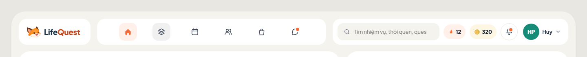
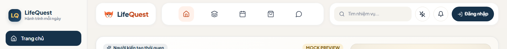

# FE-03.5B — Desktop Header Restoration Report

- **Repository:** `D:\Development\LifeQuest_Repo`
- **Branch:** `feature/tv4-frontend` (base FE-03 commit `343d3a981224eaaaad9fc83b676e85f5453cf246`)
- **Source of Truth:** `D:\Development\LifeQuest\LifeQuest Dashboard-project.zip` (`Main.dc.html`) & `docs/frontend/fe03_5/HEADER_DESIGN_COMPARISON.md`
- **Scope:** Desktop Header (`>= 1024px`) only. Sidebar (`248px`), Tablet header, Mobile header, Dashboard cards/hero, Work Hub, Calendar, Wardrobe, Backend, Mascot SDK, and Auth contracts remain unchanged.

---

## 1. Visual Comparison (`1440×900`)

### Original Claude Canvas Desktop Header (`Main.dc.html`)

### Restored Frontend Desktop Header (`1440×900`)

### Responsive Desktop Verification (`1024px`, `1280px`, `1920px`)
- **`1024×900`:** [restored_frontend_header_1024.png](screenshots/restored_frontend_header_1024.png) — compact Brand icon pill, all 5 nav icons comfortably spaced inside Island 2, zero overflow or overlap alongside the `248px` sidebar.
- **`1280×900`:** [restored_frontend_header_1280.png](screenshots/restored_frontend_header_1280.png) — full Brand wordmark + 3 non-overlapping `64px` islands.
- **`1920×900`:** [restored_frontend_header_1920.png](screenshots/restored_frontend_header_1920.png) — centered `max-width: 1200px` 3-island grid, `64px` pill height, `20px` radius, `16px` gap.

---

## 2. Restored Geometry & Functional Adaptations

- **Floating 3-Island Layout:** `80px` sticky glass bar (`rgba(245, 243, 238, 0.84)`, `backdrop-filter: blur(14px)`), `64px` `#FFFFFF` pill islands, `20px` border-radius, `16px` gap (`10px` at `1024–1180px`).
- **Island 1 (Brand):** Fox SVG emblem + two-tone `Life` (`#16324A`) `Quest` (`#C2461A`, `19px / 800`), dev subtitle removed.
- **Island 2 (Center Quick Nav):** 5 icon-only `44×44` (`radius: 14px`) route links (`/`, `/work`, `/calendar`, `/wardrobe`, `/messages`) with `#FFF1EA` active fill (`#C2461A`) and hover/focus tooltips.
- **Island 3 (Utility):**
  - Inline `#F5F3EE` `42px` (`radius: 14px`) search input connected directly to `uiStore.searchQuery`.
  - Streak (`#FFF1EA`) & Coin (`#FDF6E3`) pills rendered **only from live authenticated `GET /api/v1/today`** data (never invented or hardcoded; hidden when unauthenticated or `<= 1320px`).
  - Preserved `42×42` circular `lq-rm` reduced-motion button (`aria-pressed` & accessible label intact).
  - `42×42` circular Notification button (`1px solid #ECE8E0`) opening the honest `UNAVAILABLE` Notifications sheet (no fake unread dot).
  - Authenticated `#168C78` `40×40` initials avatar + display name + `236px` `.lq-bubble` dropdown (`Hồ sơ & Cài đặt`, `Tủ đồ Fox`, `Đăng xuất`) with zero debug/dev info; clean `Đăng nhập` pill when unauthenticated.

---

## 3. Intentional Differences Remaining vs `Main.dc.html`
1. **Left Sidebar (`248px`) Preserved:** Per FE-03.5B scope, the existing Sidebar was not modified; the 3-island Desktop Header sits inside `.mainWrap` (`calc(100% - 248px)`).
2. **No Fake Gamification / Unread Counts:** Streak/Coin pills appear only for authenticated LIVE sessions (no hardcoded `12`/`320`), and the Notification bell omits a fake unread dot until Backend Notifications exist.
3. **Reduced-Motion Button Preserved:** Kept accessible in Island 3 alongside the Notification bell so FE-01/FE-03 accessibility requirements remain 1-click.

---

## 4. Changed Files
- `front-end/src/components/shell/DesktopHeader.tsx` (new)
- `front-end/src/components/shell/DesktopHeader.module.css` (new)
- `front-end/src/components/shell/DesktopHeader.test.tsx` (new)
- `front-end/src/components/shell/AppShell.tsx` (mount `<DesktopHeader />` above `< 1024px` header)
- `front-end/src/components/shell/AppShell.module.css` (gate legacy `.header` strictly to `@media (max-width: 1023px)`)
- `front-end/src/features/dashboard/DashboardPage.test.tsx` (selector compatibility)
- `front-end/e2e/dashboard.spec.ts` (added `1024/1280/1440/1920px` 3-island non-overlap & zero-overflow assertions)
- `docs/frontend/fe03_5/HEADER_DESIGN_COMPARISON.md`, `HEADER_RESTORATION_REPORT.md`, and `screenshots/*.png`

---

## 5. Regression Test Results
- `npm run typecheck`: **PASS** (0 errors)
- `npm run lint`: **PASS** (0 errors, 0 warnings)
- `npm run build`: **PASS** (`32/32` Gate I assets verified, 1,775 modules)
- `npm run test` (Vitest): **PASS** (**11/11 files, 35/35 tests passed**)
- `npm run test:e2e` (Playwright): **PASS** (**12/12 tests passed**, including `1024×900`, `1280×900`, `1440×900`, `1920×900` Desktop Header geometry checks + Tablet `820×1180` + Mobile `390×844` + FE-01/FE-02/FE-03 regressions)

---

## 6. Known Limitations
- Work Hub popover (`Task` / `Habit` / `Quest` submenu from `Main.dc.html`) currently links directly to `/work` (matching our unified FE-02 Work Hub route).
- Separate visual review polish items (`VR-01` Mobile header clipping, `VR-02` Hero XP ring contrast, `VR-03` Wardrobe canvas height, `VR-04` Tablet pill wrapping) were intentionally left untouched to honor FE-03.5B's strict Desktop-Header-only scope.
